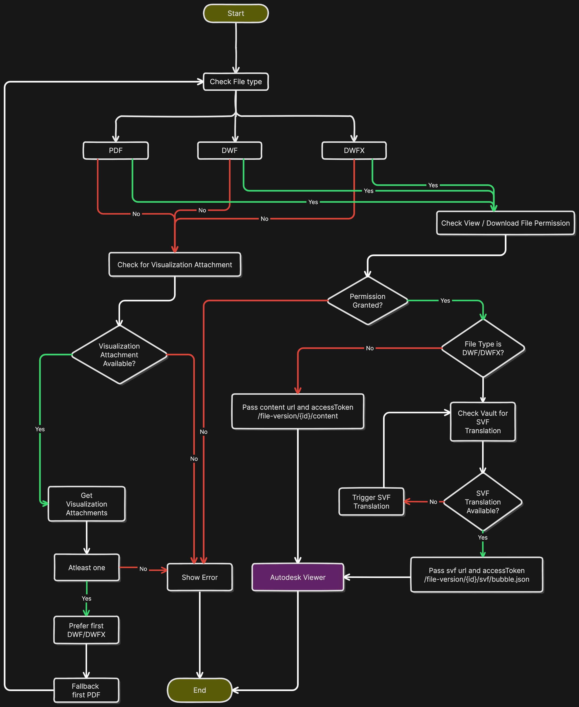

# Vault Web Demo
It is a Single Page Application (SPA), which renders on the client side (browser). Application routing is handled on the client side, rendering different UIs based on routing.

## Requirements
- Node.js (NPM)
- Editor - VS Code
- If you plan to use the lifecycle state update APIs, make sure a valid license is available.
- In ADMS Console, enter the Network License server URL first so the license check can pass.

## Framework and Libraries
- Build tool
    - Application bundle, Dev Server, Api Proxy etc - [Vite.js](https://vitejs.dev/)
- Frontend
    - UI Library - [React.js](https://react.dev/)
    - UI Components Library - [Ant Design](https://ant.design/)
    - Application routing - [Tanstack Router](https://tanstack.com/router/latest)
    - API tool - [Alova.js](https://alova.js.org/)
    - State Management - [Valtio](https://valtio.pmnd.rs/)
    - Rest Api Playground - [RapiDoc](https://rapidocweb.com/)

## Build Project
- On Command Prompt / Terminal  cd, enter the project directory.
- `npm install` - install the dependencies
- `npm run build`- build the project for production. It will generate HTML, CSS, and JS, and then copy all assets to the /dist folder. Later, we can serve it as a static file, allowing the browser to bootstrap the entire application from the client side.
- `npm run dev` - starts integrated dev server. It supports HMR and live-reloads the browser when the code changes..

The Vite dev server dynamically proxies API calls to the server selected on the login screen. Start with `npm run dev`, enter the server root address (for example `http://vault-server` or `https://your-gateway.vg.autodesk.com`), and select **Connect**. Do not include `/AutodeskDM` in the address. The demo verifies `/server-info` before enabling login and loads the available Vaults. No server address is hardcoded in Vite.

Each browser tab has a separate connection ID stored in sessionStorage. Browser requests use `/__vault/<connection-id>/AutodeskDM/...`; the local Vite middleware strips the connection prefix and forwards to the chosen server. Authorization and raw upload bytes are preserved. API Playground and Viewer resources use the same connection. The last server address is remembered for convenient input; credentials are scoped to the current tab and selected server. **Change Server** cancels requests, clears the session and cached data, and requires reconnection/sign-in. The middleware is a local development feature; run `npm run dev` for this demo.
The local middleware is implemented in [`dev/vaultProxy.js`](dev/vaultProxy.js) and registered by [`vite.config.js`](vite.config.js). Restart Vite once after updating this configuration; subsequent server changes are handled through the UI without restarting.

## API client code generation.
The canonical OpenAPI specification is `public/Vault REST Public API.yml`. API Playground loads this YAML directly, and `alova.config.js` uses the same file as the client generation input. Update this file when refreshing the API documentation; do not maintain separate specification copies. Updating the specification does not regenerate the checked-in API client. Regeneration requires reviewing changes to tags, operation IDs, and API paths against existing calls.

Alova.js helps with the generation of API client code based on the OpenAPI specification. To learn how to configure and utilize this tool, please refer to the documentation.
[Alova VS Code Extension](https://alova.js.org/tutorial/getting-started/extension-integration)

## Source layout

- `src/features/`: feature UI, state, and API operations, grouped into authentication, connection, explorer, fileUpload, items, changeOrders, and playground.
- `src/routes/`: TanStack route definitions and route parameter adapters.
- `src/layouts/`: shared workspace layout and navigation.
- `src/api/`: shared Alova client, generated API definitions, response merging, and property transformations.
- `dev/`: local Vite proxy middleware.

## Features

- Vault Login
- Workspace
  - Explorer(<optional>id=<root | folderId>)
    - Folders
    - Files
      -  Viewer(id=<file-version-id>)
    - Links
   - Items
  - ChangeOrders
  - API Explorer

## Autodesk ID Sign-in

The login screen supports both **Autodesk ID** and **Vault username**. Autodesk ID uses browser-based Authorization Code with PKCE (S256), via REST; no client secret or authentication backend is required. Existing Autodesk sessions may be reused by the authorization page.

1. Register an APS application of type **Desktop, Mobile, Single-Page App**, or use a compatible existing public-client application.
2. Register the exact callback URL displayed on the login screen, including the trailing slash. For the default development address this is `https://localhost:5173/`. A WPF callback such as `http://localhost:8080/` does not replace the web callback.
3. Enter the application's Client ID and select **Sign in with Autodesk ID**. After the redirect, select a Vault and choose **Open Vault**.
4. Ensure the Autodesk account is mapped to an authorized Vault user and has the required license. OAuth sign-in does not grant Vault permissions or a license.

OAuth access tokens are stored in sessionStorage for the current browser tab, and are sent directly as Bearer tokens to the configured Vault/Gateway proxy. The returned Vault context is used to resolve the mapped user; it does not replace the OAuth token with a Vault token. Expiry ends the demo session and requires sign-in again, matching the WPF sample; automatic refresh is not implemented. **Sign out** clears local demo credentials and cached Vault data, but does not sign out the Autodesk website.

REST is used because this project is a browser SPA; the referenced APS TypeScript SDK is documented as a Node.js SDK. See [Autodesk's browser PKCE example](https://aps.autodesk.com/blog/new-application-types) and [APS SDK for Node.js](https://github.com/autodesk-platform-services/aps-sdk-node).

## Add and Update Files

In Explorer, open the Files tab of the destination folder and select **Add File**. Choose one local file, enter an optional comment, and select **Upload and Add**.

Explorer resolves the root folder through `GET /vaults/{vaultId}/folders/root` when loading contents. The root is displayed as a selectable tree node; default folder views and uploads use its returned ID, rather than assuming the root ID is `1`.

Explorer loads folders on demand. It first obtains root metadata, then loads only the direct contents of the selected or expanded folder, with `option[searchSubFolders]=false`. The Folders, Files, and Links tabs share that folder's cached result; revisiting a loaded folder does not fetch it again. Tree expansion shows a loading icon, tables show a spinner, and paginated loads report how many entries have been received. Failures expose **Retry**. Switching server or signing out clears the folder cache and ignores late responses from the previous session. Direct file-preview links fetch only the requested file version when it is not cached.

To replace file content, select a file using the table's radio selector and select **Update File**. Select replacement content and choose whether to check out before uploading and keep the file checked out after check-in. Check-in uses the file master ID; Vault may return an unchanged result without creating a new version.

Add, update, and undo-checkout do not automatically reload the file list. Once the operation finishes, the dialog immediately offers **Close**. Use **Refresh** in the Files toolbar to reload only the current folder; a notice marks potentially outdated list data. Refresh does not traverse the rest of the Vault or hold the upload dialog open.

Both operations upload raw content sequentially in parts of at most 8 MiB (or the server's smaller limit), including a zero-byte part for empty files. Each request has a one-minute timeout. Progress counts confirmed uploaded bytes. Canceling stops requests but does not release an existing checkout; use **Undo Checkout** explicitly when appropriate. Unknown final request outcomes require checking Vault state before submitting another operation. Failed uploads always start a new upload session rather than replaying a part.

This sample handles one file at a time and does not reconstruct CAD reference relationships. All requests use the selected server's local proxy connection.

Vault username login obtains a Vault session token (`Bearer V:...`). File creation/check-in through a Gateway may require an Autodesk ID token for license validation; use Autodesk ID sign-in in that environment. A valid Vault session alone does not establish that the user meets the server's license requirements.

## Viewer Integration
Viewer is loaded in an iFrame. Once the translation is confirmed, pass the svf URL and token details to the viewer using window.postMessage.

